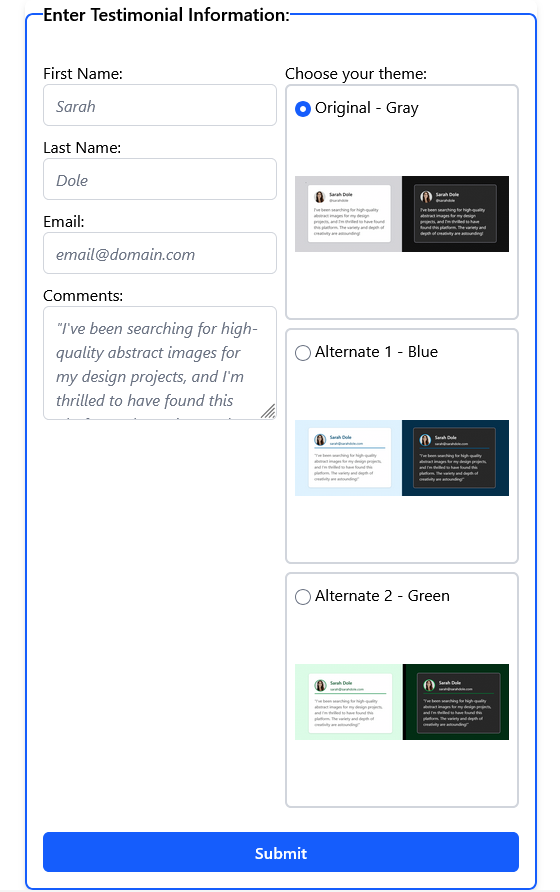
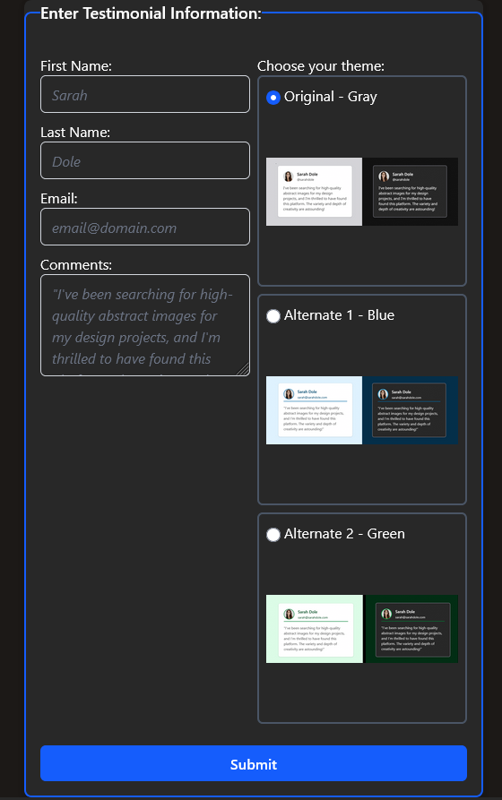
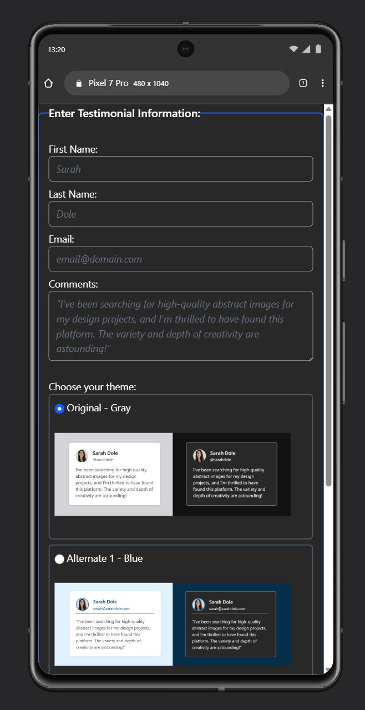

# Testimonial Card Component - React 19 + TypeScript

A functional React component, stylized with Tailwind CSS, that takes User information gathered from a form and renders a "Testimonial" Card in a Responsive Design flex container that adjusts to different screen sizes, ensuring a good user experience across devices.

This project was based on a [GreatFrontEnd](https://www.greatfrontend.com/projects) [project to develop a single Testimonial Card based on the Figma Design specifications.](https://www.greatfrontend.com/projects/challenges/testimonial-card). (The source code for my submission on that project can be viewed at this repository:[single-testimonial-card](https://github.com/notavailable4u/single-testiimonial-card)  )

I created this component, which builds on that concept by adding the ability to generate multiple cards at once, with three choices for color theme, because I wanted to try out the new Form features in React 19 and to practice both using Tailwind CSS and building projects with Vite. The project was later migrated from JavaScript to TypeScript. (November 2026)

## Features

- Renders a card for each user entered via the form which displays the user's profile picture, name, email, and comments.

- Choice of three color schemes.

- Component can be easily extended or modified to include additional user information or styling as needed.

- The profile picture is a placeholder image imported from assets, which can easily be changed to the actual picture.

- Styled with Tailwind CSS classes for a responsive and modern look.

- The component uses a dark mode theme with appropriate styling for light and dark backgrounds.

- The cards are displayed in a flex container that centers them both vertically and horizontally on the page.

- Responsive Design adjusts to different screen sizes, ensuring a good user experience across devices.

- Functional component that does not maintain any internal state, making it simple and efficient for rendering static data.

- Modular design and reusability: component can be imported and used in other applications apps and websites or be used independently to generate code for the cards.

- Written in TypeScript with strict type checking. The shape of a testimonial (`Testimonial`) and the allowed color themes (`Theme`) are defined in [`src/types.ts`](src/types.ts).

- Accessible form: every label is linked to its input, so clicking a label focuses its field and screen readers announce each field's name.

## Tech Stack

- [Vite v7](https://vite.dev) (Vite requires [Node.js](https://nodejs.org/en/) version 20.19+, 22.12+.)
- [React v19.1](https://react.dev)
- [TypeScript v5.8](https://www.typescriptlang.org/)
- [@vitejs/plugin-react](https://github.com/vitejs/vite-plugin-react/tree/main/packages/plugin-react)
- [TailwindCSS v4.1](https://tailwindcss.com/)
- [ESLint v9](https://eslint.org/) with [typescript-eslint](https://typescript-eslint.io/)
- [Figma](https://www.figma.com/) for original Testimonial Card design implementation

## Project Structure

```
src/
├── main.tsx         # App entry point
├── InputForm.tsx    # Form for entering testimonials and choosing a theme
├── CreateCard.tsx   # Renders a card for each testimonial
├── Footer.tsx       # Footer note
├── types.ts         # Shared Testimonial and Theme types
├── vite-env.d.ts    # Vite client types (e.g. for image imports)
├── index.css        # Tailwind CSS entry
└── assets/          # Images and screenshots
```

## Installation

1. Clone the repository

```
git clone https://github.com/notavailable4u/testimony-card-component.git
```

2. Navigate to project directory

```
cd testimony-card-component
```

3. Install Dependencies

```
npm install
```

4. Start the dev server

```
npm run dev
```

5. Open the app in your browser at http://localhost:5173/testimony-card-component/ (the path matches the `base` set in `vite.config.ts` for GitHub Pages)

## Scripts

| Command           | Description                                                                 |
| ----------------- | --------------------------------------------------------------------------- |
| `npm run dev`     | Start the Vite dev server                                                   |
| `npm run build`   | Type-check with `tsc -b`, then build for production into `dist/`. Type errors fail the build. |
| `npm run lint`    | Lint all `.ts` and `.tsx` files with ESLint                                 |
| `npm run preview` | Serve the production build locally                                          |

## Deployment

The site is deployed to GitHub Pages by the [deploy workflow](.github/workflows/deploy.yml) on every push to `main`. The workflow installs dependencies, runs `npm run build` and publishes the `dist/` folder.

`dist/` is listed in `.gitignore` and is not committed: it is generated by the build, both locally and in CI.

## Screenshots

**Input Form**



**Input Form - Dark Mode**



**Testimonial Card - Original Theme - Gray**


**Testimonial Card - Alternate Theme 1 - Blue**


**Testimonial Card - Alternate Theme 2 - Green**


**Pixel 7 Pro Mockup View**


